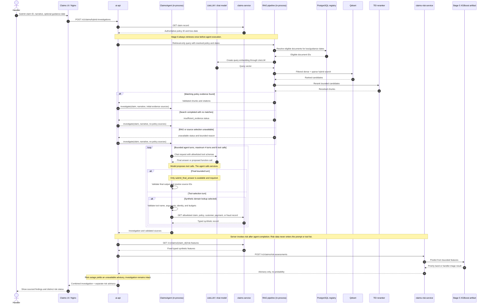

# Stage 6 - Hybrid Claims Investigation

Status: **IN PROGRESS**
Pattern: Agent + ML + RAG orchestration
Builds on: Stage 2 hybrid RAG, Stage 4 bounded claims agent, Stage 5 synthetic referral model

## 0. Problem statement

The platform has three separate capabilities: the Stage 4 agent gathers synthetic claim-domain
facts and optional policy evidence; Stage 2 RAG returns temporally scoped, cited policy evidence;
Stage 5 returns an advisory synthetic human-review referral band from five bounded structured
features. The existing frontend calls only the Stage 3 RAG investigation endpoint. The roadmap names
Stage 6 "Agent + ML + RAG orchestration" without defining a user-facing contract.

Stage 6 connects these capabilities for one synthetic claim investigation while keeping the risk
signal separate from evidence-backed statements. Current claim records do not contain the Stage 5
features, so the synthetic service must expose explicit fixture-owned values rather than deriving
features from narrative or model output.

## 1. Approved scope

- A new `POST /v1/claims/hybrid-investigations` endpoint; the existing Stage 3 and Stage 4 API
  contracts remain available and unchanged.
- Request fields: `claim_id`, `narrative`, and optional `guidance_as_of`. Resolve policy ID and loss
  date from the validated claims-service record.
- Run existing hybrid RAG retrieval deterministically before the Stage 6 agent. Forward an explicit
  guidance date to RAG; otherwise use the claim loss date. Pass validated chunks as source-linked,
  untrusted initial evidence to the agent without a second RAG answer-generation call.
- Return policy evidence status separately as `retrieved`, `insufficient_evidence`, or `unavailable`.
  Retrieval/source-selection failure does not masquerade as a successful search with no matching
  evidence and does not suppress the independent agent/risk result.
- Add fixed, bounded Stage 5 feature values for controlled synthetic claims and expose them through
  a typed internal claims-service endpoint. Do not add features to the agent's `get_claim` response.
- Call the risk service deterministically in server orchestration, outside LLM prompts and tools.
  Return a separate advisory response containing priority band or handler-triage status, model
  version, or an explicit unavailable state. Do not return probabilities.
- If feature lookup or risk inference fails, preserve the completed investigation and set risk state
  to unavailable with a sanitized reason.
- Make the combined endpoint the primary route in the existing handler frontend. Render risk advice
  separately from sourced investigation findings and policy evidence.
- Trace the combined investigation and bounded risk call without claim narrative, raw features,
  labels, or full service payloads.
- Keep the workflow local, unauthenticated, and synthetic-only. Do not claim production readiness.

## 2. Out of scope

- Real claim/customer information or submission of real PII.
- Fraud determination, coverage decision, approval/denial, payment action, writes, or persisted
  predictions/feedback.
- LLM-selected risk calls, deriving model inputs from narrative, or exposing risk inputs/results as
  agent evidence or source IDs.
- Model retraining, changing the Stage 5 target/rubric/threshold, or making new claims about model
  quality beyond the existing synthetic evaluation.
- Temporal workflows (Stage 7), specialist agents (Stage 8), observability-platform expansion
  (Stage 9), or Stage 10 production infrastructure.
- Expanding the Stage 4 saved all-domain evaluation claim: its known payment/fraud source omissions
  remain a documented limitation.

## 3. Architecture and contracts

### Call-flow diagram

The LLM is a planner/answer generator behind LiteLLM, not a service client. `ClaimsAgent` validates
each proposed tool call against its allowlist and bounds before executing HTTP requests. For Stage 6,
RAG runs inside the API process before the agent and calls PostgreSQL, Qdrant, TEI, and LiteLLM for
query embeddings. It skips RAG answer generation; the agent receives retrieved chunks as untrusted,
source-linked context. The Stage 5 XGBoost model runs inside the separate risk service after the
agent completes; it does not make coverage or fraud decisions.

1. The API validates the new request and reads the claim record from the internal synthetic claims
   service. The claim record supplies authoritative `policy_id` and `loss_date`.
2. The API runs retrieval-only hybrid RAG using the resolved policy ID/loss date and optional
  guidance date. It validates and converts retrieved chunks into source-linked policy evidence;
  it does not invoke the RAG answer generator. Empty results and retrieval/source-selection
  failures map to distinct policy-evidence statuses.
3. The API creates the existing `AgentInvestigationInput` from claim ID and narrative and runs the
  bounded Stage 4 agent with validated RAG sources in its initial untrusted context. The combined
  route does not expose a model-selectable RAG tool. Risk feature data is never passed to the agent.
4. The API reads `/v1/claims/{claim_id}/risk-features` from the claims service. The response
   contains `claim_id`, `assessment_complete`, and the existing `ClaimRiskFeatures` schema. The
   service rejects unknown claim IDs and does not accept caller-supplied features.
5. The API posts this typed feature assessment to the existing internal
   `/v1/claims/risk-assessments` endpoint. Service failures are converted to a separate unavailable
   state; malformed output is categorized as `invalid_response`.
6. The combined response contains claim/policy/date context, policy-evidence status, the full
  validated agent result, a separate risk assessment, request latency, and trace ID. Existing
  endpoint contracts are not changed.

The risk assessment state is `available` or `unavailable`. Available results preserve the Stage 5
fields: `priority_band`, `handler_triage_required`, `triage_reason`, and `model_version`.
Unavailable results include only a bounded reason (`feature_service_unavailable`,
`risk_service_unavailable`, or `invalid_response`). No probability is returned. Risk outages do not
mean no referral and do not change the agent's investigation status.

The fixed fixture vectors are synthetic test inputs only. `CL-123` has one date inconsistency and
one missing-evidence indicator; `CL-124` has zero counts. They are not outcomes or real risk labels.
Stage 5's existing label rubric and model remain unchanged.

## 4. Safety, privacy, and observability

- Keep all model traffic behind LiteLLM. Mandatory RAG query embeddings use LiteLLM; retrieval-only
  mode skips a separate RAG answer-generation call. Perform no automatic provider-backed retries.
- Bound the claims feature lookup and risk inference timeouts; validate response identity, shape,
  and feature ranges before use.
- Keep risk calls server-owned and deterministic. The LLM cannot invoke or select the risk service.
- Keep risk results out of the agent prompt, tool history, findings, citations, and RAG evidence.
- Use sanitized client errors for claim/agent/RAG dependency failures. Risk-service failures are
  represented only in the bounded risk state.
- Add a `claims.risk_advisory` span with bounded outcome, model version, latency, and failure
  category. Do not attach narratives, raw features, labels, or full request/response bodies.
- The frontend labels the signal as a separate advisory and states that it is not a claim decision.

## 5. Implementation slices

1. **Contracts and decision — complete:** add request/response schemas and accepted ADR-013. Keep
   Stage 3/4 contracts unchanged.
2. **Synthetic feature boundary — in progress:** add fixture-owned risk features, typed lookup
   endpoint, and package the shared feature schema in the claims-service image.
3. **API orchestration — in progress:** configure the internal risk-service URL, add a validated
   risk adapter and combined endpoint, and forward optional `guidance_as_of` into the RAG evidence
   adapter.
4. **Frontend — in progress:** switch to the combined request/response, make claim service data
   authoritative for policy/loss date, display source-linked findings and policy excerpts, and
   render available/triage/unavailable risk states separately.
5. **Tests/evaluation — in progress:** cover fixture schema/ranges, successful and failed risk
   calls, source separation, guidance-date handling, UI partial response, and desktop/mobile
   overflow. Add a report with actual measurements and limitations.
6. **Deployment/closeout — pending:** build/load pinned Stage 6 API and claims-service images,
   verify local rollout and traces, then update project handoff docs with actual results.

## 6. Acceptance criteria

- Request uses claim ID, narrative, and optional guidance date; policy and loss date are resolved
  from the claims service.
- Every combined investigation runs one retrieval-only `hybrid_rerank` search before agent execution.
  Retrieved policy chunks are validated sources in the agent's initial context; the LLM cannot skip
  retrieval or invoke a second RAG tool on the combined route.
- Policy evidence status distinguishes `retrieved`, successful `insufficient_evidence`, and
  `unavailable` source-selection/retrieval failure.
- Unknown claims and invalid requests fail with bounded sanitized responses.
- Fixed feature vectors are served only for known synthetic fixtures, validate against the existing
  Stage 5 feature schema, and are not caller-controlled or LLM-visible.
- Risk is invoked by server orchestration, not by model tool selection. The combined response keeps
  risk output distinct from investigation findings and evidence.
- Risk outage or malformed response preserves the investigation and returns an explicit unavailable
  risk state; normal agent/RAG failures keep their own sanitized error behavior.
- The existing RAG-only and agent-only API contracts remain unchanged.
- The UI clearly separates risk advice from source-backed findings and supports priority, routine,
  triage, and unavailable states without layout overflow.
- Tests verify no feature values, claim narrative, raw PII, or labels appear in logs or spans.
- Kustomize renders; pinned local images build/load; workloads become ready; one synthetic combined
  request has a collector-correlated trace.
- Evaluation reports integration behavior and limitations without claiming real-world model quality,
  broad agent reliability, or production readiness.

## 7. Verification

- `./.venv/bin/python -m pytest -q tests/unit`
- `./.venv/bin/python -m pytest -q tests/integration`
- `cd apps/frontend && npm run test:coverage && npm run build && npm run test:e2e`
- `./.venv/bin/python -m py_compile apps/ai-api/main.py apps/claims-service/main.py agents/claims/*.py`
- `bash -n scripts/*.sh`
- `kubectl kustomize infrastructure/kubernetes/base >/dev/null`
- Build/load changed images, verify rollout, send one synthetic combined request without automatic
  retries, and correlate its trace in the collector.
- `git diff --check`

## 8. Decisions and execution record

- User approved deterministic separate risk advice, fixture-owned features, API and existing UI,
  partial response on risk outage, a new combined endpoint, and claim ID + narrative + optional
  guidance date on 2026-10-06.
- Python authoring convention: new or modified Python files include a concise file-level
  comment/docstring explaining purpose; inline comments are reserved for non-obvious logic.
- Verification (2026-10-06): Python 3.12 backend suite 307 passed/2 skipped; focused claims/agent
  coverage 87% (risk adapter 95%); frontend 14 tests passed with 98.76% line coverage; desktop/mobile
  Playwright 6 passed; production build, compile, shell syntax, Kustomize, and `git diff --check`
  passed. Stage 6 images built/loaded and `ai-api` plus `claims-service` rolled out successfully.
- One synthetic combined smoke returned HTTP 200 in 2,778 ms, with three claim/policy/customer tool
  sources and Stage 5 `routine_review` from model `stage5-cfb12f6a9cc1`. Trace
  `cdf96f1cf435bfee28cfbd7278b5bec5` correlated with `claims.hybrid_investigation` and
  `claims.risk_advisory`; no raw features or labels appeared in inspected spans. The model-selected
  flow did not call optional RAG evidence in this request. This is not a live Stage 6 RAG citation
  check or a model-quality claim. Full results and limitations: [Stage 6 integration report](eval/stage6-hybrid-ai-report.md).
- Stage 6 remains in progress pending user review; no real-world quality or production-readiness
  claim is made.
- Decision amendment (2026-10-07): user selected deterministic retrieval for every combined
  investigation. `RagQueryService` now supports retrieval-only mode; the combined API invokes it
  before the agent, injects validated sources into the initial context, and reports retrieval state
  separately. Backend suite: 315 passed/2 skipped; focused agent/RAG coverage: 87%; frontend: 15
  tests passed, 98.8% line coverage, production build passed, and Playwright: 6 passed. Python
  compile, shell syntax, Kustomize, and `git diff --check` passed.
- Live mandatory-retrieval verification (2026-10-07): user reported `policy_evidence_status=retrieved`
  with trace `0826761b079e1dfc1e0de72aadca0b8d`. Collector confirms source resolution, dense/sparse
  embedding, hybrid search, reranking (20 candidates/results), combined investigation with evidence
  status `retrieved`, and risk status `available`. `agent.source_count=8` and `agent.tool_calls=3`.
  No `rag.generate` span is expected in retrieval-only mode. Full trace record: [Stage 6 evaluation
  report](eval/stage6-hybrid-ai-report.md). This does not establish model quality or production
  readiness.